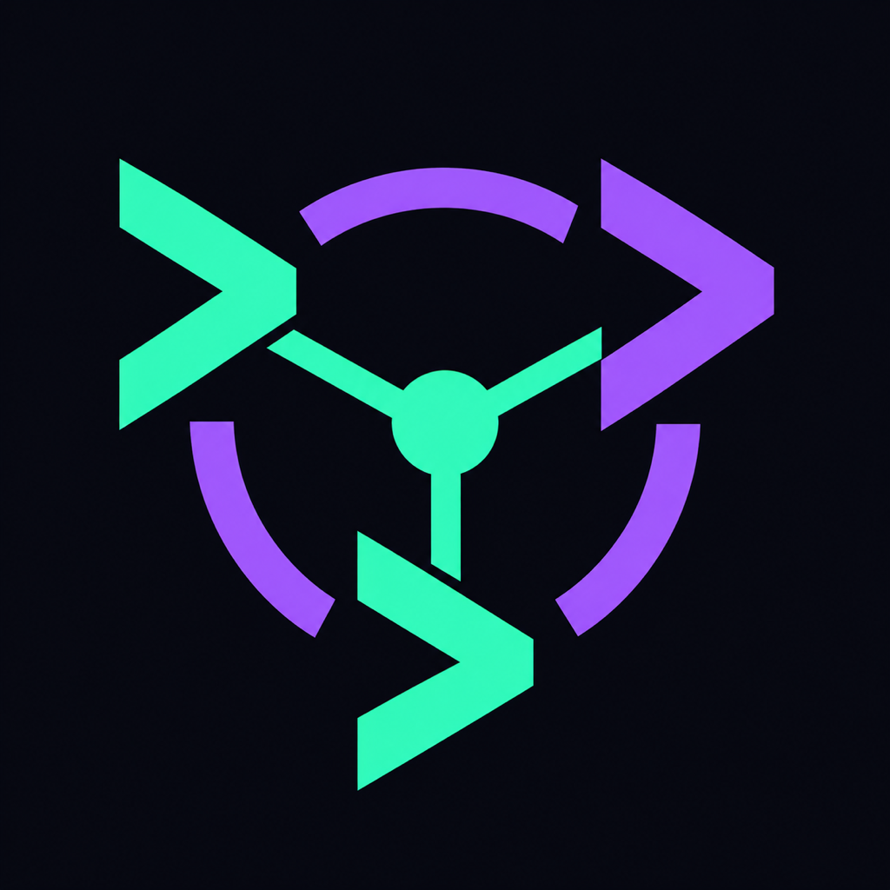

<p align="center">
  
</p>

# Central Agent CLI

A terminal UI that runs Claude Code, Codex and Antigravity over the Agent Client Protocol (ACP), and lets agents delegate work to each other over A2A. For example, Claude can ask Codex to generate an image.

## Usage

```sh
cargo run                       # open the TUI
cargo run -- --resume claude    # open the TUI with Claude's past sessions listed
cargo run -- agents             # list agents
cargo run -- add local --kind ollama --model qwen3.5:2b-mlx
```

Inside the TUI: click or Tab to switch agents, Enter to send, `/resume` to reopen a past session, `/new` to start fresh, Ctrl+C to quit.

## Tests

```sh
cargo test
```
